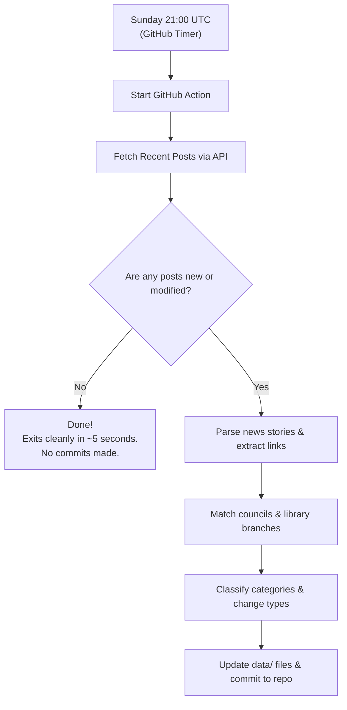

# Automation & GitHub Actions

[🏠 Home](../index.md) · [Overview](overview.md) · [Data Structure](data-structure.md) · [Entity Matching](entity-matching.md) · [Consuming the Data](consuming-the-data.md) · [Automation](automation.md)

---

> **Who is this page for?**
> * **Library users & curators**: Read how the weekly Sunday updates happen automatically without anyone needing to sit at a computer or press buttons.
> * **Developers & sysadmins**: Review the GitHub Actions workflow definition, incremental caching, rate-limiting, and backfill instructions.

---

## Weekly Schedule

This repository runs completely on automatic pilot using **GitHub Actions**. Every **Sunday evening at 21:00 UTC (9:00 PM UK time)**, the scheduled job triggers automatically:



### Why the weekly job is considerate:
* **Zero Web Scraping Load**: The scraper queries the official WordPress REST API (`/wp-json/wp/v2/posts`) rather than downloading large web pages.
* **Instant Exit on No Changes**: It checks the WordPress post ID and `modified` timestamp against `data/posts_index.json`. If no new or updated posts exist, it terminates immediately.
* **Neat Commit History**: Commits are only made if genuine new stories were published, keeping the Git repository clean.
* **Zero Cloud Costs**: Uses standard GitHub-hosted Linux runners within free open-source tier quotas.

---

## Manual Execution (Workflow Dispatch)

You can also trigger a run manually at any time directly from the GitHub website:

1. Visit the **Actions** tab on GitHub: [Actions Tab](https://github.com/LibrariesHacked/public-libraries-news/actions).
2. Click **Scrape Public Libraries News** in the left sidebar.
3. Click the **Run workflow** dropdown on the right:
   * **Incremental mode** (default): Quickly checks for the newest posts.
   * **Backfill mode**: Traverses backward through the archive history. You can optionally specify the number of pages (e.g. `5` or leave blank for everything).
4. Click the green **Run workflow** button.

---

## Historical Backfilling via CLI

To backfill historical posts back to 2010 locally, the scraper can be run with `--mode backfill`:

```bash
# Backfill the 10 most recent historical pages (500 posts)
python -m src.cli --mode backfill --pages 10

# Or run a full historical backfill
python -m src.cli --mode backfill
```

### Safe Backfill Safeguards:
* Automatically pauses for 1.5 seconds between page requests to avoid placing load on the host server.
* Checks previously recorded posts to skip duplicate work.
* Automatically updates all year-by-year summary files (`data/stories/YYYY.json`) and the catalog index (`data/posts_index.json`).
