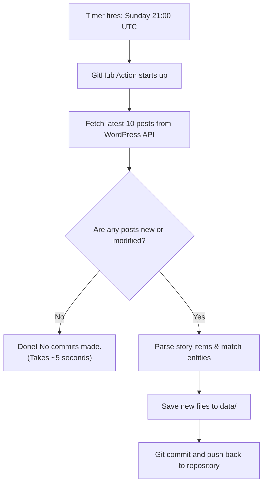

# Automation & GitHub Actions

This repository runs completely on automatic pilot using **GitHub Actions**. You do not need to keep a computer running or manually trigger anything for weekly updates.

---

## Weekly Schedule

Every **Sunday evening at 21:00 UTC (9:00 PM UK time)**, the scheduled job triggers automatically:



### Why Incremental Runs Are Considerate:
* The script only queries the latest page of posts.
* It checks the unique WordPress ID and `modified` timestamp against `data/posts_index.json`.
* If the post has already been recorded and has not been edited, the script **exits immediately**.
* It places almost zero load on the Public Libraries News website.
* It only makes a git commit if genuine new stories were added, keeping the git history neat and clean.

---

## Manual Execution (Workflow Dispatch)

You can also trigger a run manually at any time directly from GitHub:

1. Go to the **Actions** tab on GitHub: [Actions Tab](https://github.com/LibrariesHacked/public-libraries-news/actions).
2. Click **Scrape Public Libraries News** on the left menu.
3. Click the **Run workflow** dropdown on the right:
   * **Incremental mode** (default): Quickly checks for the latest posts.
   * **Backfill mode**: Traverses backward through the archive history. You can optionally specify the number of pages (e.g. `5` or leave blank for everything).
4. Click the green **Run workflow** button.

---

## Historical Backfilling

To backfill historical posts back to 2010, the scraper can be run locally or via GitHub Actions with `--mode backfill`:

```bash
# Backfill the 10 most recent historical pages (500 posts)
python -m src.cli --mode backfill --pages 10

# Or backfill the complete historical archive
python -m src.cli --mode backfill
```

During backfill, the scraper:
* Automatically pauses for 1.5 seconds between page requests to be considerate to the host server.
* Identifies previously processed posts and avoids duplicate work.
* Updates all year-by-year summary files automatically.
