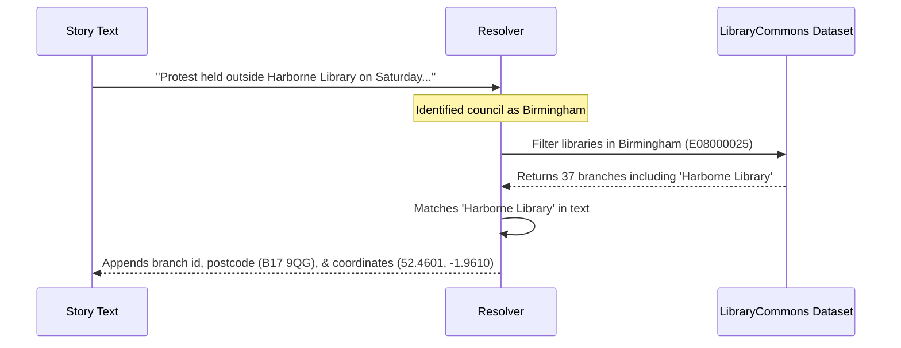

# Entity Matching & Data Resolution

One of the main improvements in this project is automatically linking news text to real-world places, councils, and individual library branches.

This document explains how this matching works in plain English.

---

## 1. Matching UK Local Authorities

Each story under **Local news by authority** or **Changes** usually begins with a bold name followed by a dash (for example, `Barnsley –` or `Cheshire West —`).

The system checks this name against `data/lookups/uk_authorities.json`. This lookup contains:
* Official council names across **England, Scotland, Wales, and Northern Ireland**.
* Official **Government Statistical Service (GSS/ONS) codes** (e.g. `E08000016` for Barnsley).
* Common nicknames, abbreviations, and previous council names (e.g. `Cheshire West` maps to *Cheshire West and Chester*, `RCT` maps to *Rhondda Cynon Taf*).
* Geographic coordinates (latitude and longitude) for council centroids.

---

## 2. Matching Specific Library Branches

When a story is linked to a local authority, we also want to know if **specific library buildings** are mentioned.

To do this, we use the open **LibraryCommons dataset** ([LibrariesHacked/libraryon-commons](https://github.com/LibrariesHacked/libraryon-commons)), which tracks over 4,200 public library branches across the UK.

### How branch matching works:
1. When a story is identified as belonging to **Birmingham City Council**, the system looks at the list of libraries situated within Birmingham.
2. It scans the story text for branch names (for example, *Harborne Library*, *Selly Oak*, or *Library of Birmingham*).
3. When it spots a branch name:
   * It attaches the official library identifier (`id`).
   * It records the library name, postcode, status (open/closed), and exact map coordinates.
   * This allows any mapping application to place pins on the exact library buildings featured in the news!

---

## 3. Matching International News

Under the **International news** section, stories usually begin with a country or city name (for example, `USA –`, `Canada —`, `Australia -`, or `Finland –`).

The system checks these against `data/lookups/countries.json`:
* Recognizes countries and aliases (e.g. `USA`, `America`, `United States` all map to *United States* with country code `US`).
* Sets the story type to `country`.

---

## 4. Automatic Classification & Taxonomy

To make it easy to find and analyze stories across all 16 years, each story is automatically classified using a dedicated library-sector taxonomy:

### The 15 Core Themes
1. **`cuts_and_finance`**: Budgets, financial savings, Section 114 council bankruptcy notices, funding, and capital investments.
2. **`closures_and_threats`**: Branch closures, endangered libraries, and closure threats.
3. **`staffing_and_unions`**: Staffing cuts, redundancies, UNISON action, strikes, and professional librarian posts.
4. **`events_and_activities`**: Author talks, workshops, Summer Reading Challenge, exhibitions, and coding clubs.
5. **`campaigns_and_protests`**: Grassroots campaigns, petitions, demonstrations, judicial reviews, and legal challenges.
6. **`volunteers_and_community`**: Community-managed libraries, volunteer handovers, and asset transfers.
7. **`digital_and_technology`**: AI, ebooks, digital services, computer access, public Wi-Fi, and maker spaces.
8. **`refurbishment_and_new_builds`**: Renovations, facility modernizations, revamps, and brand-new library openings.
9. **`opening_hours`**: Changes to opening schedules, weekend reductions, and expanded evening access.
10. **`book_bans_and_challenges`**: Book censorship, challenges to LGBTQ+/Pride displays or stock, and restricted access.
11. **`mobile_and_outreach`**: Mobile library vans, home library services, and rural outreach.
12. **`governance_and_trusts`**: Leisure trusts, charitable mutuals, in-sourcing, and alternative governance (e.g. GLL, Libraries Unlimited).
13. **`co_location`**: Community hubs, shared civic centres, and co-located council services.
14. **`warm_spaces_and_wellbeing`**: Warm banks, cost-of-living support hubs, food bank drop-ins, and public health hubs.
15. **`unstaffed_open_plus`**: Technology-enabled unstaffed access ("Open+", "Open Libraries").

### Change Types (for the *Changes* section)
For stories published in the **Changes** section, the system categorizes the nature of the change into:
* `closure`: Library buildings closing permanently or temporarily.
* `reduction_or_cut`: Reductions in hours, mobile stops, or staffing.
* `community_handover`: Handover of council-run branches to volunteer or community groups.
* `investment_or_expansion`: New branches opening, major refurbishments, or expanded hours.
* `unstaffed_open_plus`: Implementation of automated unstaffed hours.
* `other`: Governance or general changes.

### Sector Bodies & Financial Mentions
* **Sector Bodies**: Automatically detects mentions of key organisations: DCMS, Arts Council England, CILIP, Libraries Connected, UNISON, The Reading Agency, British Library, Welsh Government, and SLIC.
* **Financial Mentions**: Extracts specific financial figures (e.g. `£2.3m`, `£450k`) referenced in the story.
* **Source Domains**: Extracts the clean domain name (e.g. `bbc.co.uk`, `theguardian.com`, `birminghammail.co.uk`) from every hyperlink.

---

## 5. How to Update or Add an Authority

If a council changes its name or Ian Anstice uses a new abbreviation, you don't need to change any code. You can simply edit `data/lookups/uk_authorities.json` and add the new term to the `"aliases"` list for that authority.
