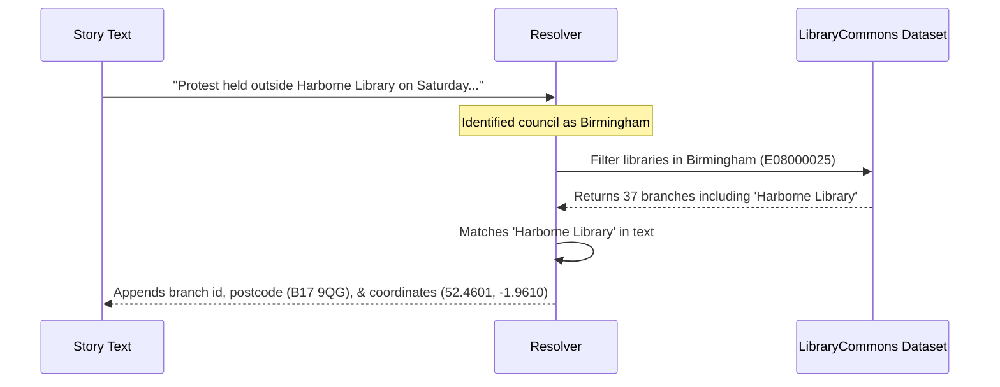

# Entity Matching & Data Resolution

One of the main improvements in this project is automatically linking news text to real-world places, councils, and individual library branches.

This document explains how this matching works in plain English.

---

## 1. Matching UK Local Authorities

Each story under **Local news by authority** or **Changes** usually begins with a bold name followed by a dash (for example, `Barnsley –` or `Cheshire West —`).

The system checks this name against `data/lookups/uk_authorities.json`. This lookup contains:
* Official council names across **England, Scotland, Wales, and Northern Ireland**.
* Official **Government Statistical Service (GSS/ONS) codes** (e.g. `E08000016` for Barnsley).
* Common nicknames, abbreviations, and previous council names (e.g. `Cheshire West` maps to *Cheshire West and Chester*, `RCT` maps to *Rhondda Cynon Taf*).
* Geographic coordinates (latitude and longitude) for council centroids.

---

## 2. Matching Specific Library Branches

When a story is linked to a local authority, we also want to know if **specific library buildings** are mentioned.

To do this, we use the open **LibraryCommons dataset** ([LibrariesHacked/libraryon-commons](https://github.com/LibrariesHacked/libraryon-commons)), which tracks over 4,200 public library branches across the UK.

### How branch matching works:
1. When a story is identified as belonging to **Birmingham City Council**, the system looks at the list of libraries situated within Birmingham.
2. It scans the story text for branch names (for example, *Harborne Library*, *Selly Oak*, or *Library of Birmingham*).
3. When it spots a branch name:
   * It attaches the official library identifier (`id`).
   * It records the library name, postcode, status (open/closed), and exact map coordinates.
   * This allows any mapping application to place pins on the exact library buildings featured in the news!

---

## 3. Matching International News

Under the **International news** section, stories usually begin with a country or city name (for example, `USA –`, `Canada —`, `Australia -`, or `Finland –`).

The system checks these against `data/lookups/countries.json`:
* Recognizes countries and aliases (e.g. `USA`, `America`, `United States` all map to *United States* with country code `US`).
* Sets the story type to `country`.

---

## 4. Automatic Topic Tagging

To make it easy to find stories by theme, each story is scanned for common library topics:

| Tag | Keywords Detected |
|---|---|
| `closures` | closure, closed, closing |
| `cuts` | cuts, budget, savings, section 114, deficit |
| `opening_hours` | hours, opening hours, reduced hours |
| `consultation` | consultation, survey, feedback |
| `unstaffed_access` | unstaffed, open+, open plus, automated access |
| `volunteers` | volunteer, community-run, community led, handover |
| `refurbishment` | refurbishment, renovated, reopening, new library |
| `campaign` | campaign, protest, petition, demonstration |
| `industrial_action`| strike, UNISON, dispute |
| `mobile_libraries` | mobile library, mobiles |

---

## 5. How to Update or Add an Authority

If a council changes its name or Ian Anstice uses a new abbreviation, you don't need to change any code. You can simply edit `data/lookups/uk_authorities.json` and add the new term to the `"aliases"` list for that authority.
