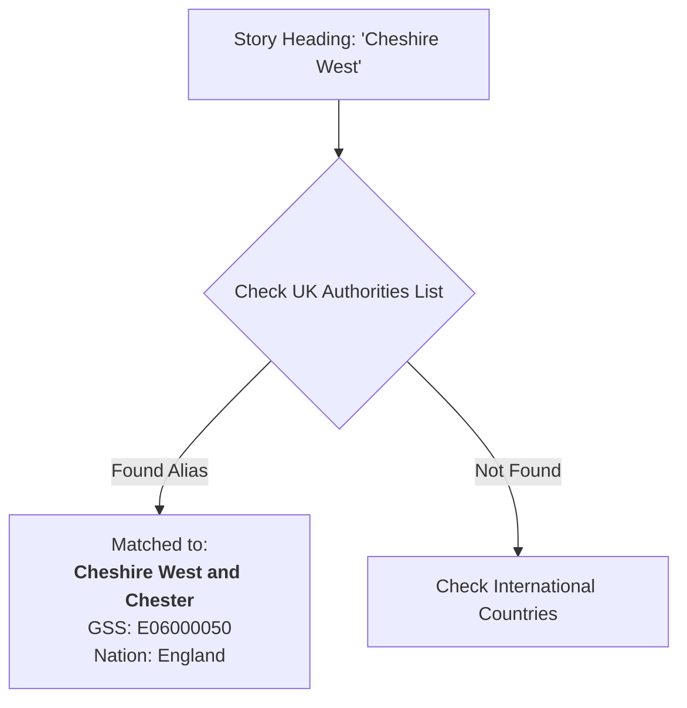
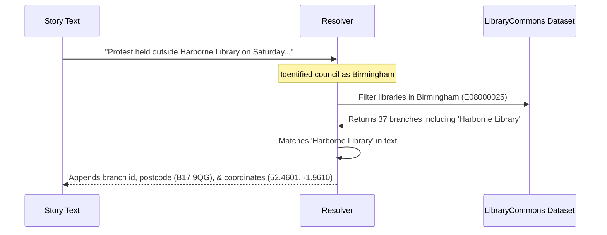

# Entity Matching & Taxonomy

[🏠 Home](../index.md) · [Overview](overview.md) · [Data Structure](data-structure.md) · [Entity Matching](entity-matching.md) · [Consuming the Data](consuming-the-data.md) · [Automation](automation.md)

---

> **Who is this page for?**
> * **Library users & campaigners**: Read about how the scraper recognizes your local council, why library branches get tagged, and how you can suggest new aliases if your council isn't matching.
> * **Developers & data researchers**: Learn about the deterministic lookup algorithm, the 15-category sector taxonomy, and how branch-level coordinates are extracted using the LibraryCommons dataset.

---

## 1. Matching UK Local Authorities

Stories in the **Local news by authority** and **Changes** sections usually begin with a bold heading indicating the council, followed by a dash (e.g. `Barnsley –`, `Cheshire West —`, or `Edinburgh -`).

The system resolves this heading against `data/lookups/uk_authorities.json`. This reference lookup contains:
* Official local authority names across **England, Scotland, Wales, and Northern Ireland**.
* Official **Government Statistical Service (GSS/ONS) codes** (e.g. `E08000016` for Barnsley, `S12000036` for Edinburgh).
* Common aliases, abbreviations, and informal names (e.g. `Cheshire West` maps to *Cheshire West and Chester*, `RCT` maps to *Rhondda Cynon Taf*).
* Geographic coordinates (latitude and longitude) for council centroids.

### How to improve council matches
If you notice a council name or informal abbreviation that is not matching, you can add it to `data/lookups/uk_authorities.json` under that council's `aliases` array. No coding is needed—just submit a quick pull request or open an issue on GitHub!

---

## 2. Matching Specific Library Branches

When a story is linked to a council, we also want to know if **specific library buildings** are mentioned.

To do this, we use the open **LibraryCommons dataset** ([LibrariesHacked/libraryon-commons](https://github.com/LibrariesHacked/libraryon-commons)), which tracks over 4,200 public library branches across the UK.

### How branch matching works:
1. When a story is identified as belonging to **Birmingham City Council**, the system filters the lookup for libraries situated within Birmingham (`E08000025`).
2. It scans the story text for known branch names (e.g. *Harborne Library*, *Selly Oak Library*, or *Library of Birmingham*).
3. When it finds a branch:
   * It attaches the unique library identifier (`id`).
   * It records the official library name, postcode, status (open/closed), and exact map coordinates.
   * This enables maps and finder applications to place pins on the exact buildings featured in the news!

---

## 3. Matching International News

Under the **International news** section, stories usually begin with a country or city name (for example, `USA –`, `Canada —`, `Australia -`, or `Finland –`).

The system checks these against `data/lookups/countries.json`:
* Recognizes ISO countries and common aliases (e.g. `USA`, `America`, and `United States` all map to *United States* with country code `US`).
* Resolves major international cities and states (e.g. `New York`, `Toronto`, `Melbourne`).
* Sets the entity type to `country`.

---

## 4. Automatic Classification & Taxonomy

To make it easy to find and analyze stories across all 16 years, each story is automatically classified using a dedicated library-sector taxonomy:

### The 15 Core Themes

| Category | Topics Covered | Example Keywords |
|---|---|---|
| **`cuts_and_finance`** | Budgets, funding cuts, savings targets, Section 114 council bankruptcies, capital funding | *budget, cuts, savings, deficit, section 114, s114, funding* |
| **`closures_and_threats`** | Branch closures, closure threats, endangered libraries | *closure, closed, closing, threat, threatened, axed* |
| **`staffing_and_unions`** | Redundancies, strike action, UNISON disputes, librarian posts | *staff, staffing, unison, strike, redundancy, librarian* |
| **`volunteers_and_community`** | Community libraries, volunteer handovers, asset transfers | *volunteer, volunteering, community-run, community-led, handover* |
| **`opening_hours`** | Reduced hours, weekend cuts, expanded evening opening | *hours, opening hours, reduced hours, opening times* |
| **`unstaffed_open_plus`** | Automated access technology ("Open+", "Open Libraries") | *unstaffed, staffless, open+, open plus, openplus, automated access* |
| **`refurbishment_and_new_builds`** | Renovations, new library buildings, modernizations | *refurbishment, renovated, reopen, new library, revamp, facelift* |
| **`campaigns_and_protests`** | Grassroots campaigns, petitions, demonstrations, legal challenges | *campaigners, protest, demonstration, petition, save our library* |
| **`book_bans_and_challenges`** | Book censorship, challenges to LGBTQ+/Pride books, restricted access | *book ban, challenged, censorship, restricted, pride, trans books* |
| **`events_and_activities`** | Author talks, workshops, Summer Reading Challenge, clubs | *activities, event, author, workshop, exhibition, summer reading* |
| **`digital_and_technology`** | AI, ebooks, digital services, computers, public Wi-Fi | *digital, ebooks, e-books, computer, wifi, artificial intelligence* |
| **`mobile_and_outreach`** | Mobile library vans, home delivery services, rural outreach | *mobile library, van, outreach, home library service* |
| **`governance_and_trusts`** | Leisure trusts, charitable mutuals, bringing services in-house | *trust, leisure trust, mutual, in-house, gll, libraries unlimited* |
| **`warm_spaces_and_wellbeing`** | Warm banks, cost of living hubs, food bank drop-ins, public health | *warm space, warm bank, warm welcome, wellbeing, cost of living* |
| **`co_location`** | Community hubs, shared civic centres, health/library co-locations | *co-location, hub, community hub, shared building, civic centre* |

### Change Types (for the *Changes* section)

Stories in the **Changes** section summarize tangible alterations to library services. The system assigns a `change_type`:
* **`closure`**: Permanent or temporary closure of buildings.
* **`reduction_or_cut`**: Reduction in opening hours, mobile stops, or staffing.
* **`community_handover`**: Transfer from council operation to volunteer/community groups.
* **`investment_or_expansion`**: New buildings, major refurbishments, or expanded hours.
* **`unstaffed_open_plus`**: Introduction of staffless access technology.
* **`other`**: Reorganisations or governance adjustments.

### Sector Bodies & Financial Mentions

* **Sector Bodies**: Automatically detects mentions of key organisations: DCMS, Arts Council England, CILIP, Libraries Connected, UNISON, The Reading Agency, British Library, Welsh Government, and SLIC.
* **Financial Figures**: Extracts monetary figures (e.g. `£2.3m`, `£450k`) referenced in the story.
