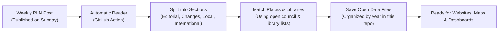

# Project Overview

## What is this project?

Every week, [Public Libraries News](https://www.publiclibrariesnews.com/) (curated by Ian Anstice and partnered with The Library Campaign) publishes a comprehensive roundup of what is happening to public libraries across the United Kingdom and internationally.

This repository automatically reads each new post on Sunday evening, splits the news into individual, searchable stories, and links each story to:
* The relevant **Local Authority** (e.g. Birmingham, Barnsley, Edinburgh, Cardiff).
* Specific **Library Branches** mentioned (e.g. Harborne Library, Mitchell Library).
* The **Country** (for international stories such as the USA, Canada, or Australia).

All the collected data is stored as plain, open data files directly inside this GitHub repository. Anyone can use this data for free to build maps, dashboards, research reports, or search tools.

---

## How It Works in Plain English

1. **Scheduled Check**: Every Sunday night at 9:00 PM (UK time), an automated process runs on GitHub.
2. **Checking for New News**: It asks the Public Libraries News website if a new weekly post has been published.
   * If there are **no new posts**, it quietly stops without changing anything.
   * If a **new post is found**, it reads the content.
3. **Organizing the Stories**: It reads the editorial notes, and then takes each item in sections like *Changes*, *Local news by authority*, and *International news*.
4. **Linking Names to Real Places**:
   * It recognizes the council name (e.g. "Cheshire West" is linked to *Cheshire West and Chester* and assigned official government code `E06000050`).
   * It scans the text to see if individual library buildings are mentioned (e.g. "Harborne Library").
   * It preserves all links to original sources, council minutes, and newspaper articles.
5. **Saving Open Files**: The structured files are committed right into the `data/` folder in this repository, ready for anyone to download or connect to.

---

## Why Pure Data (No AI Needed)?

We deliberately designed this system to run **purely from reliable code and open reference datasets**, without needing an artificial intelligence (AI) model:
* **Predictable & Transparent**: Library names and council areas are matched using clear lookup tables. You can always see exactly why a story was linked to a council.
* **100% Free to Run**: Because it does not use commercial AI tokens or paid APIs, this repository can run forever for free on GitHub Actions.
* **Lightning Fast**: An entire weekly roundup is processed and linked in less than one second.
* **Easy to Improve**: If a new council or nickname appears in a post, anyone can easily add it to the lookup file with a simple edit.

---

## Content License & Attribution

All news content extracted from Public Libraries News is made available under the **Creative Commons Attribution (CC BY 4.0)** license, respecting the work of Ian Anstice and The Library Campaign.

When using this data in your own applications, please include attribution:
> *Source: Public Libraries News (https://www.publiclibrariesnews.com/), curated by Ian Anstice / The Library Campaign.*
