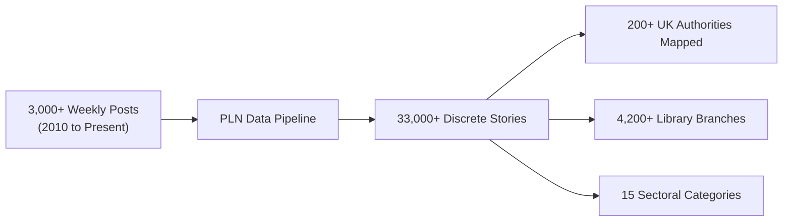

# Public Libraries News Open Data

Welcome to the open data repository for [Public Libraries News](https://www.publiclibrariesnews.com/) (PLN), curated by **Ian Anstice** in partnership with **The Library Campaign**. 

Every week since 2010, Public Libraries News has chronicled the developments, changes, campaigns, and innovations across public library services in the United Kingdom and around the world. This project automatically converts those weekly roundups into clean, structured, open data files that anyone can search, analyze, and build with.

---

## Navigation

* [🏠 Home](index.md)
* [📖 Project Overview](docs/overview.md) — What this project does and how it works in plain English
* [📊 Data Structure & Schemas](docs/data-structure.md) — File formats, field explanations, and JSON examples
* [🔍 Entity Matching & Taxonomy](docs/entity-matching.md) — How councils, libraries, and topics are matched without AI
* [⚡ Consuming the Data](docs/consuming-the-data.md) — Direct download URLs and code snippets (JS, Python, cURL)
* [🤖 Automation & Scheduling](docs/automation.md) — How the automated Sunday night GitHub Actions job runs

---

## Choose Your Path

This documentation is organized so you can quickly find what you need depending on your background:

### 📚 For Library Users, Campaigners & Observers
> **You don't need any programming skills to explore this data!**

* **What is in this dataset?** Every weekly roundup published on Public Libraries News is split into individual news items. Each item is tagged with the council responsible, any specific library branches mentioned (like *Harborne Library* or *Central Library*), and the topic (such as funding cuts, closures, extended hours, or volunteer handovers).
* **Where can I get the data?** You can download files directly using the links below and open them in web browsers or online JSON viewers:
  * [Download Latest News (`latest.json`)](https://raw.githubusercontent.com/LibrariesHacked/public-libraries-news/main/data/latest.json) — The newest weekly post and all its extracted stories.
  * [Download All Posts Index (`posts_index.json`)](https://raw.githubusercontent.com/LibrariesHacked/public-libraries-news/main/data/posts_index.json) — Complete list of every post published since 2010.
  * [Browse Yearly Stories](https://github.com/LibrariesHacked/public-libraries-news/tree/main/data/stories) — Pre-packaged files containing every story for each calendar year.
* **Can I use this data?** Yes! The news text is published under the [Creative Commons Attribution 4.0 International (CC BY 4.0)](https://creativecommons.org/licenses/by/4.0/) license. You are free to share and adapt it as long as you give credit to Ian Anstice and The Library Campaign.
* **Read more**: Start with the [Project Overview](docs/overview.md) for a non-technical summary with visual diagrams.

---

### 💻 For Developers, Data Journalists & Researchers
> **Fast, deterministic data pipelines with zero third-party runtime dependencies.**

* **Pure Data Architecture**: Built using Python 3 standard library (`urllib.request`, `html.parser`, `dataclasses`). Requires no external scrapers, headless browsers, or paid AI APIs.
* **Deterministic Entity Resolution**: Automatically resolves UK local authority names and aliases to official GSS/ONS codes, and maps branch mentions to 4,200+ UK libraries from [LibraryCommons](https://github.com/LibrariesHacked/libraryon-commons).
* **Automated Weekly Ingestion**: Runs on GitHub Actions every Sunday at 21:00 UTC, using WordPress REST API endpoints with incremental modification checks (< 10 seconds execution).
* **Pre-computed Taxonomies**: Every story is tagged across 15 sectoral categories (e.g. `cuts_and_finance`, `closures_and_threats`, `volunteers_and_community`, `book_bans_and_challenges`).
* **Read more**: Jump into [Data Structure](docs/data-structure.md) for JSON schemas, or [Consuming the Data](docs/consuming-the-data.md) for integration examples.

---

## At a Glance: Archive Numbers

| Metric | Total | Description |
|---|---|---|
| **Archive Coverage** | **2010 – Present** | Over 16 years of weekly public library history |
| **Indexed Posts** | **3,000+** | Every Sunday roundup and editorial commentary |
| **Extracted Stories** | **33,000+** | Discrete news items from Changes, Local, and International sections |
| **Authority Matching Rate** | **~88%** | Matched to official UK local authority GSS codes |
| **Branch Directory** | **4,200+** | Library locations with coordinates from LibraryCommons |
| **Weekly Execution Cost** | **$0.00** | Runs entirely on free GitHub Actions with standard library code |

---

## Direct Data Downloads

All datasets are hosted in this repository and available via GitHub's raw CDN:

| Dataset | Format | Direct URL | Description |
|---|---|---|---|
| **Latest Digest** | JSON | [`data/latest.json`](https://raw.githubusercontent.com/LibrariesHacked/public-libraries-news/main/data/latest.json) | Most recent weekly post, editorial, and parsed stories |
| **Posts Index** | JSON | [`data/posts_index.json`](https://raw.githubusercontent.com/LibrariesHacked/public-libraries-news/main/data/posts_index.json) | Catalog of all weekly posts with titles, dates, and story counts |
| **Yearly Stories** | JSON | [`data/stories/2024.json`](https://raw.githubusercontent.com/LibrariesHacked/public-libraries-news/main/data/stories/2024.json) | Complete collection of stories for a calendar year (2010–2026) |
| **UK Council Lookup** | JSON | [`data/lookups/uk_authorities.json`](https://raw.githubusercontent.com/LibrariesHacked/public-libraries-news/main/data/lookups/uk_authorities.json) | UK library authorities, aliases, and official GSS codes |
| **Library Directory** | JSON | [`data/lookups/libraries.json`](https://raw.githubusercontent.com/LibrariesHacked/public-libraries-news/main/data/lookups/libraries.json) | UK public library branches with postcodes and coordinates |
| **Country Directory** | JSON | [`data/lookups/countries.json`](https://raw.githubusercontent.com/LibrariesHacked/public-libraries-news/main/data/lookups/countries.json) | ISO countries and capital city aliases for international stories |

---

## Attribution & Copyright

* **News Content**: Scraped text from Public Libraries News is licensed under the **[Creative Commons Attribution 4.0 International (CC BY 4.0)](https://creativecommons.org/licenses/by/4.0/)** license.
* **Credits**: When publishing or displaying this data, please credit **Ian Anstice** and **The Library Campaign** as the original authors, with a link to [https://www.publiclibrariesnews.com/](https://www.publiclibrariesnews.com/).
* **Software & Tooling**: Code and scripts in this repository are available under the **[MIT License](https://opensource.org/licenses/MIT)**.
